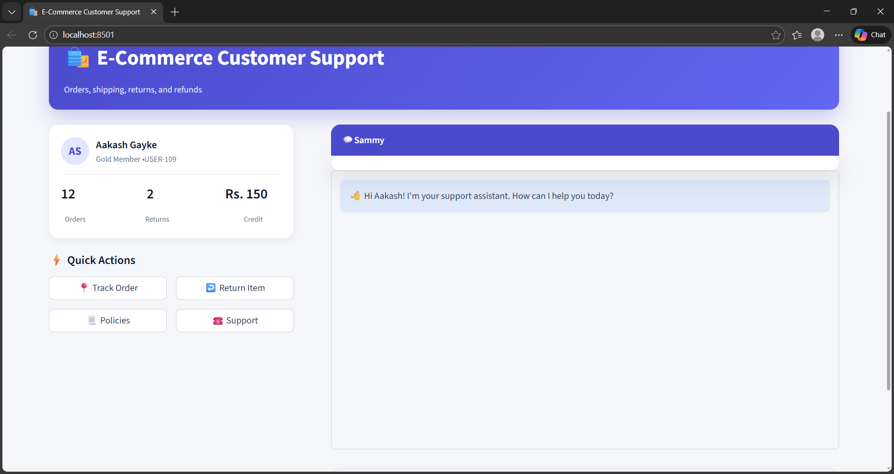
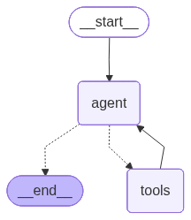
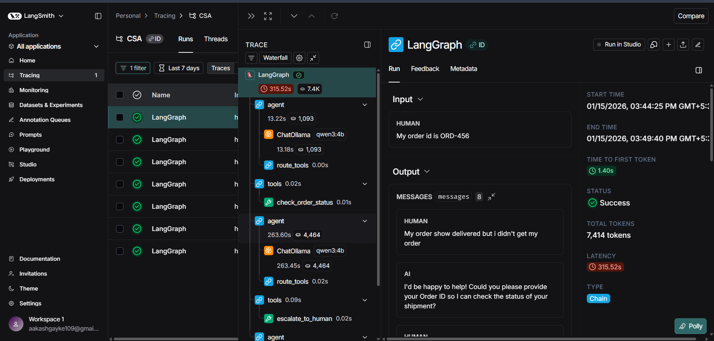

# 🛍️ E-Commerce Customer Support Agent

An AI-powered **Customer Support Agent for the eCommerce industry**, built using **LangChain**, **LangGraph**, **Ollama**, **RAG**, and **Streamlit**.




This project simulates a real-world customer support system capable of handling:
- 📦 Order tracking
- 🚚 Shipping queries
- 🔄 Returns & refunds
- ❓ General FAQs
- 🎫 Support ticket creation
- 📞 Escalation to human agents

---
## 🧠 Agent Workflow (LangGraph)

The following diagram shows how the AI agent processes user queries using a LangGraph-based workflow.

- The agent node reasons over the user query
- If a tool is required, the request is routed to the tool node
- Tool output is sent back to the agent for final response
- The workflow continues until a final answer is generated




---

## 🔍 LangSmith Execution Trace

LangSmith is used to monitor, debug, and analyze each step of the agent's reasoning and tool usage.

Below is a snapshot of a real execution trace showing:
- Agent reasoning steps
- Tool invocation
- Message flow between nodes



---

## 🎥 Video Demo

Watch a complete demo of the AI agent, including:
- Workflow explanation
- Tool execution
- LangSmith tracing
- End-to-end query handling

[](https://youtu.be/dlsvk0g1UZs)

---

## 🚀 Tech Stack

- **Python**
- **LangChain & LangGraph**
- **Ollama (Local LLM – Qwen)**
- **FAISS (Vector Store)**
- **SQLite (Conversation persistence)**
- **Streamlit (Frontend UI)**

---

## 🧠 Architecture Overview

- **LangGraph** manages agent state, tool routing, and conversation flow
- **Tools** handle order tracking, returns, tickets, and RAG-based search
- **RAG** retrieves answers from policy PDFs (Shipping, Returns, FAQs)
- **SQLite Checkpointing** enables multi-threaded persistent chats
- **Streamlit UI** provides a clean, chat-style customer support experience

---

## 📂 Project Structure

```

Project/
├── app.py                    # Streamlit UI
├── main.py                   # LangGraph agent & workflow
├── tools.py                  # Tools (orders, returns, RAG, tickets)
├── prompt.py                 # System prompt
├── requirements.txt
├── Storage/
│   ├── ticket_store.py       # Ticket persistence
│   └── tickets.json
└── rag/
    ├── retriever.py          # FAISS retriever loader
    ├── vectorstores/         # FAISS indexes
    └── docs/
       ├── returns/
       ├── shipping/
       └── general/

````

---

## ⚙️ How to Run the Project

### 1️⃣ Clone the repository
```bash
git clone https://github.com/Aakash109-hub/eCommerce-Customer-Support-Agent.git
cd ecommerce-customer-support-agent
````

### 2️⃣ Install dependencies

```bash
pip install -r requirements.txt
```

### 3️⃣ Start Ollama & pull model

```bash
ollama pull qwen3:4b
ollama run qwen3:4b
```

### 4️⃣ Run the Streamlit app

```bash
streamlit run app.py
```

---

## ✨ Key Features

* 💬 Chat-based customer support interface
* 🧠 Tool-using AI agent with LangGraph
* 📄 RAG-powered policy answering from PDFs
* 🎫 Automatic support ticket creation
* 🔄 Return initiation workflow
* 📞 Human escalation support
* 💾 Persistent chat history with SQLite
* 🖥️ Modern, responsive UI

---

## 📌 Use Cases

* AI-powered customer support automation
* RAG-based document Q&A systems
* AI agent + tool orchestration demos

---

## 🔮 Future Improvements

* Real database integration for orders
* Authentication & user accounts
* Admin dashboard for tickets
* Multi-language support
* Deployment on cloud (Docker / AWS)

---

## 👤 Author

**Aakash**
